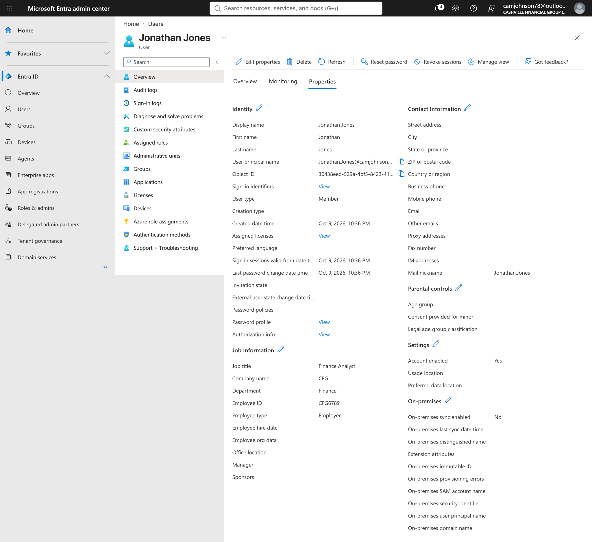
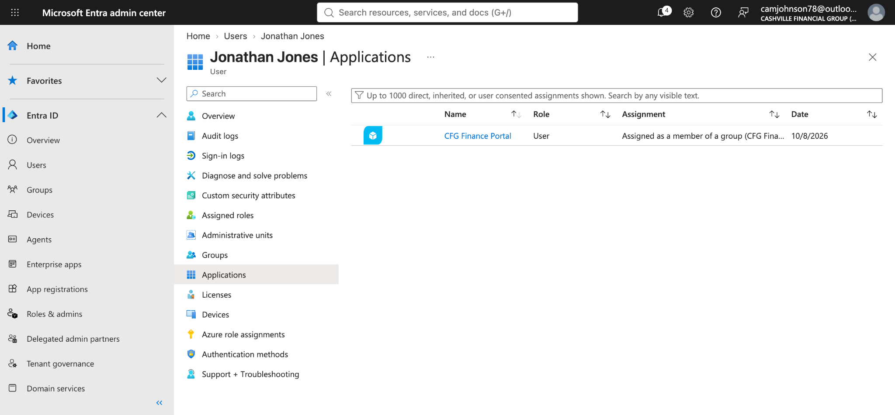
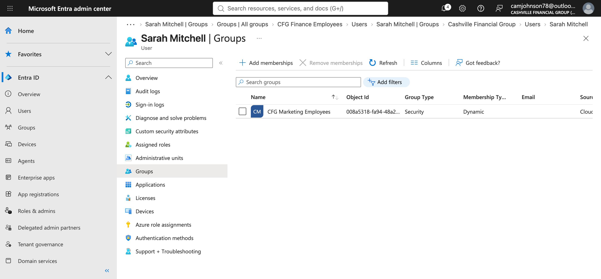
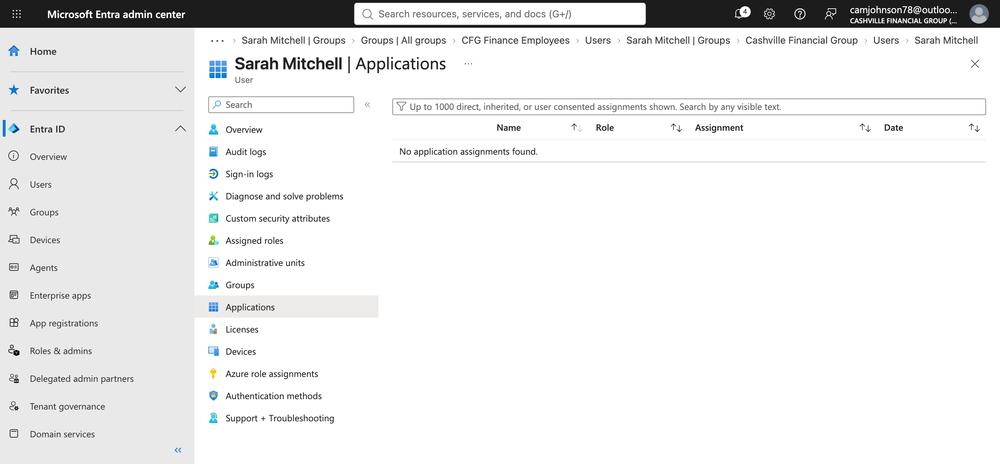
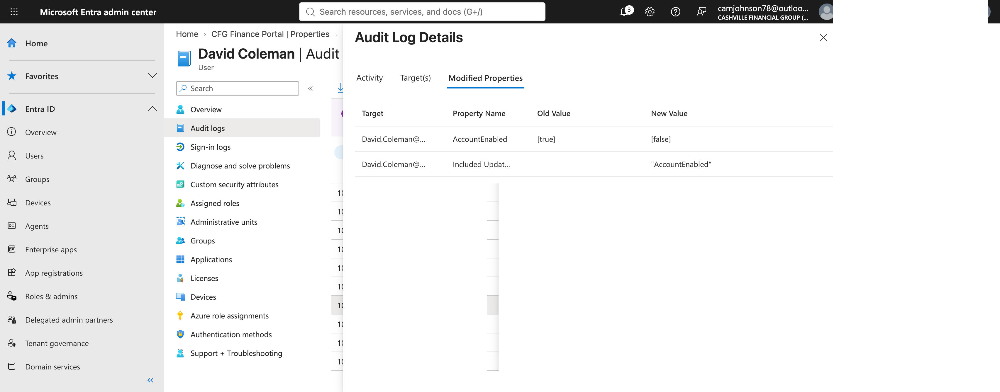

# Phase 2 — Identity Lifecycle Management | Cashville Financial Group (CFG)

**Microsoft Entra ID · Joiner–Mover–Leaver (JML) · Dynamic Security Groups · Enterprise Application Assignments · Audit Logs**

> **Portfolio lab:** CFG is a simulated financial-services organization. All users, applications, and organizational events are lab scenarios; this project does not represent a production deployment.

## Executive summary

Designed and tested identity lifecycle controls in Microsoft Entra ID for a simulated financial-services organization. The implementation demonstrates attribute-based dynamic security group membership, group-based enterprise application assignments, automatic adjustment of inherited access when department attributes change, and manual offboarding safeguards supported by audit evidence.

**Core distinction:** Identity creation, attribute edits, account disablement, and session revocation were performed administratively. Dynamic group membership and group-derived application assignments were evaluated by Entra ID. This is **not** a claim of end-to-end HR-driven provisioning or SCIM-based downstream account deprovisioning.

## Architecture / access flow

```text
Identity record (department, company, employee type)
                      |
                      v
        Entra ID dynamic security group
                      |
                      v
       Enterprise application assignment
             (CFG Finance Portal)
```

For offboarding, administrators separately disable sign-in, revoke Entra sessions, inspect access, and verify changes in audit logs.

## Scenarios and outcomes

### 1. Joiner — Jonathan Jones (CFG employee)

- Created an enabled Entra ID user with **Department: Finance**, **Company: CFG**, **Employee type: Employee**, **Job title: Finance Analyst**, and **Employee ID: CFG6789**.
- Verified membership in the **CFG Finance Employees** dynamic security group.
- Verified that **CFG Finance Portal** appeared as a **group-inherited** enterprise application assignment.
- Captured identity attributes, dynamic group membership, and inherited enterprise application assignment in the screenshots below.

### 2. Mover — Sarah Mitchell (Finance → Marketing)

- Updated the identity's department/job information to reflect a move to Marketing.
- Verified removal from the Finance dynamic group and membership in the Marketing dynamic group after rule evaluation.
- Verified that the **group-derived CFG Finance Portal assignment disappeared** when Sarah no longer qualified for the Finance group.
- Applied least-privilege reasoning: confidential M&A workspace access should not be assigned to the entire Marketing department merely because one Marketing employee requires it.
- **Boundary:** This validates Entra group-derived application assignment changes; it does not alone prove removal of a downstream application account or termination of an active app session.

### 3. Leaver — David Coleman (external contractor)

- Created a contractor identity with **Department: Finance**, **Company: Apex Consulting**, **Employee type: Contractor**.
- Confirmed David was not a member of the employee-only Finance group and had no enterprise application assignments shown in the reviewed user views.
- Disabled the Entra account and revoked Entra sign-in sessions.
- Verified **AccountEnabled: true → false** and the **StsRefreshTokensValidFrom** timestamp update in audit details.
- **Boundary:** The revocation operation invalidates applicable refresh sessions; existing access tokens and independent application sessions may require additional controls. No pre-existing group or app entitlement was available to demonstrate entitlement removal for David.

## Security controls demonstrated

| Control | Implementation | Evidence |
|---|---|---|
| Attribute-based access | Dynamic security groups use identity attributes | Finance rule and identity screenshots |
| Least privilege | Contractor excluded from employee-only access | David's attributes, group and app views |
| Role/department change | Finance → Marketing membership transition | Sarah before/after group screenshots |
| Group-based app access | CFG Finance Employees assigned to CFG Finance Portal | Enterprise app assignment screenshot |
| Access removal | Finance app assignment no longer inherited by Sarah | Sarah's application views |
| Account containment | David's account disabled | Account status and audit log |
| Session containment | Entra sign-in sessions revoked | Confirmation and audit log |
| Auditability | Reviewed modified properties and operation details | Audit screenshots |

## Selected evidence — six key screenshots

These six screenshots summarize the identity-to-access lifecycle. The [complete 26-image evidence index](EVIDENCE_INDEX.md) provides additional before/after states, configuration details, and audit records.

### Joiner: attribute-based group membership and inherited access





### Mover: access follows department changes





### Leaver: disablement and audit verification




**Supporting configuration and troubleshooting:** [Finance dynamic rule](screenshots/CFG-Phase2-Finance-Dynamic-Group-Rule.png) · [Finance Portal group assignment](screenshots/CFG-Phase2-Finance-Portal-Group-Assignment.png) · [Employee-type rule limitation](screenshots/CFG-Phase2-Dynamic-Rule-EmployeeType-Unsupported.png)

## Engineering lessons

- **Identity-data quality is critical:** A dynamic rule can operate exactly as configured while producing an undesirable access outcome if an authoritative attribute is wrong.
- **Group membership is not equivalent to every form of access:** Group-derived Entra assignment, downstream app provisioning, and active sessions are separate concerns.
- **Least privilege requires exceptions:** A department-wide group should not receive sensitive, individual-specific workspace permissions.
- **Offboarding requires layered controls:** Disabling sign-in and revoking sessions are complementary actions; audit logs provide evidence of the administrative operations.

## Scope and limitations

- Cloud-only Entra ID lab; no on-premises AD DS or HRIS integration demonstrated.
- No claim of automated user creation from an authoritative HR system.
- No claim of SCIM-based application provisioning or downstream app-account deletion.
- No proof of real CFG Finance Portal authentication or application-side session termination.
- No access certification campaign, PIM implementation, or production SLA measured in this phase.

## Evidence inventory

See [EVIDENCE_INDEX.md](EVIDENCE_INDEX.md) for the complete screenshot inventory and what each artifact supports.

## Interview-ready explanation

> I built an Entra ID identity lifecycle lab for a simulated financial services organization. I configured attribute-driven dynamic security groups and assigned a finance enterprise application through group membership. I validated that a Finance employee inherited the assignment, that a transfer to Marketing removed the inherited Finance assignment, and that a contractor was excluded from employee-only access. For offboarding, I disabled the contractor account, revoked Entra sessions, and verified the changes using audit records. I distinguish automated membership evaluation from administrative actions and from downstream app provisioning.
